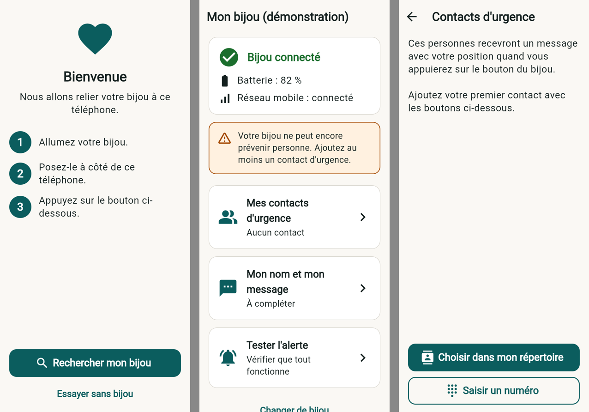
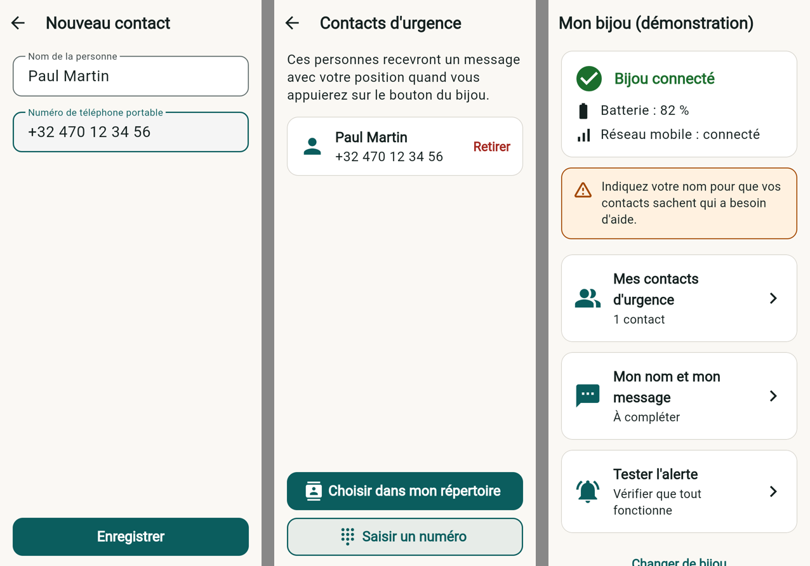

# Hestia

Bijou connecté avec bouton d'urgence : une pression envoie la position du
porteur par SMS à ses contacts. Prototype sur Thingy:91 X.

- `app/` — application mobile (Flutter, Android et iPhone) pour régler le bijou.
- `firmware/` — firmware du bijou pour le Thingy:91 X (voir `firmware/README.md`).
- `docs/protocole-ble.md` — dialogue entre l'application et le bijou.

## Application




L'application permet de relier le bijou au téléphone, de choisir les contacts
d'urgence, de saisir son nom et le message d'alerte, de voir l'état du bijou
(batterie, réseau mobile) et d'envoyer une alerte de test.

Les réglages sont enregistrés sur le téléphone puis envoyés au bijou dès qu'il
est à portée.

### Lancer l'application

Il faut [Flutter](https://docs.flutter.dev/get-started/install) et un téléphone
branché (le Bluetooth ne fonctionne pas sur émulateur).

```bash
cd app
flutter run
```

Sans bijou, le lien « Essayer sans bijou » de l'écran d'accueil lance un mode
démonstration avec un bijou simulé.

### Tests

```bash
cd app
flutter test
```
